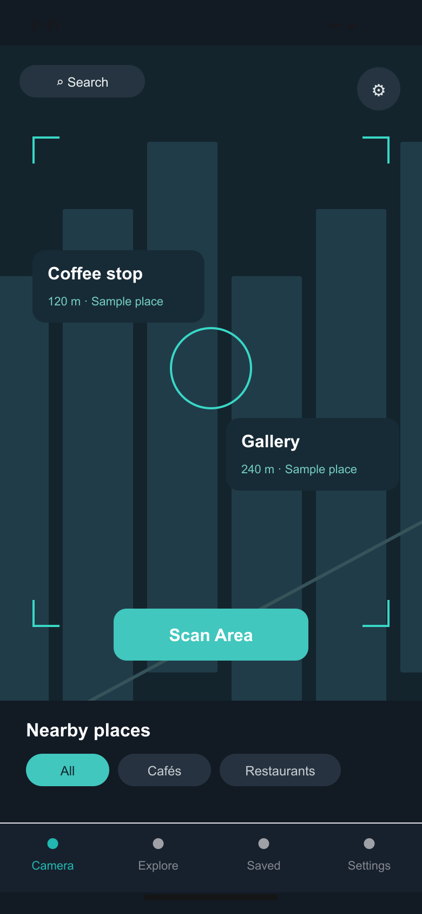
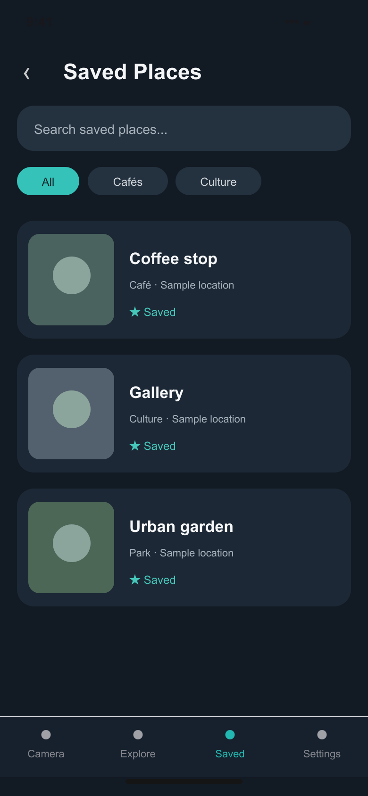

# Portfolio screens

Prepared for the Davin Cuaso portfolio on 6 November 2026.

These are source-based interface recreations with fictional sample data. They are not screenshots from a running native app or backend. Camera scenes and ingredient illustrations are schematic; measurements, saved places, and study statistics are sample content.

The SVG files are editable masters; PNG files are opaque exports.

## Camera-style discovery

Source: [components/city-lens/ar-camera-screen.tsx](https://github.com/davincuaso/CityLens/blob/e048865c04635b536b4b48224f633f8b993abd99/components/city-lens/ar-camera-screen.tsx), [app/globals.css](https://github.com/davincuaso/CityLens/blob/e048865c04635b536b4b48224f633f8b993abd99/app/globals.css).

## Saved places

Source: [components/city-lens/saved-places-screen.tsx](https://github.com/davincuaso/CityLens/blob/e048865c04635b536b4b48224f633f8b993abd99/components/city-lens/saved-places-screen.tsx).

